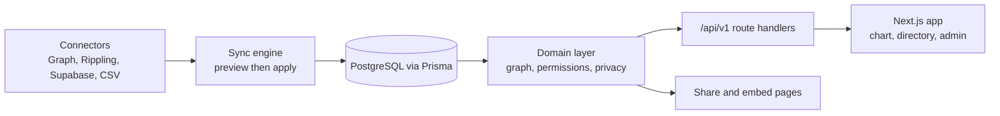

# OrgPulse (Omni org chart)

An internal org chart and organisational intelligence app for HR and operations teams, where people and positions are stored separately and the chart is drawn from the reporting graph between positions.

The app calls itself **Omni** in the UI and in `package.json`. The repository is called `orgpulse`. Both names refer to the same project.

Live demo (in memory data, no database): https://org-chart-ruby.vercel.app

See [FAILURES.md](./FAILURES.md) for what can go wrong, what broke, how it was fixed, and results.

## What it does

- Stores **positions** and **people** as separate records, so a vacancy is a position with nobody assigned and a person can move without the structure changing.
- Builds the reporting graph (solid and dotted line managers) and lays the chart out automatically with ELK.
- Directory, departments, locations, groups, skills and OKR pages over the same data.
- CSV import and export, with spreadsheet formula prefixing on export.
- Connectors for Microsoft Graph (Entra ID), Rippling and Supabase. Each has a mock mode so nothing external is needed locally.
- Share links and embeds for read only charts, scenario planning, an audit log and role based access (`OWNER`, `ADMIN`, `EDITOR`, `VIEWER`).
- An optional "Ask" assistant that calls the DeepSeek API, switched off until `DEEPSEEK_API_KEY` is set.

## How it works



Next.js 16 (App Router) serves both the UI and a JSON API under `/api/v1`. Every API handler goes through `apiHandler` in `src/server/http/handler.ts`, which resolves the session and checks the permission for that action. Prisma talks to PostgreSQL. Auth.js handles sign in with demo credentials, plus Entra ID SSO when its three variables are set.

If `DATABASE_URL` is empty, or it points at a local database while running on Vercel, the app switches to an in memory demo dataset instead (`src/demo/mode.ts`). That is how the hosted demo runs.

Deeper design notes: [ARCHITECTURE.md](./ARCHITECTURE.md), [DATA_MODEL.md](./DATA_MODEL.md), [INTEGRATIONS.md](./INTEGRATIONS.md), [SECURITY.md](./SECURITY.md), [TODO.md](./TODO.md) and [docs/MICROSOFT_SETUP.md](./docs/MICROSOFT_SETUP.md).

## Quick start

Needs Docker and Node. `package.json` asks for Node 24; the steps below were also checked on Node 20.19 and worked, with an engine warning.

```bash
docker compose up -d db          # Postgres 16 on host port 55433
cp .env.example .env
npm ci
npx prisma migrate deploy        # or: npm run db:migrate while developing
npm run db:seed
npm run dev                      # or: npm run build && npm start
```

Then open the app on port 3000 and sign in with one of the seeded accounts. All four share the password `OrgPulse!dev`.

| Role | Email |
| --- | --- |
| Owner | `owner@northstar.example` |
| Admin | `admin@northstar.example` |
| Editor | `editor@northstar.example` |
| Viewer | `viewer@northstar.example` |

The seed is a fictional company called Omni. None of the people are real.

To run the app container as well: `docker compose --profile full up -d --build`.

## Real output

From a fresh clone on 1 November 2026. The seed step printed:

```json
{
  "organisation": "northstar",
  "people": 150,
  "positions": 160,
  "vacant": 10,
  "individualContributors": 123,
  "chart": "Omni — Company",
  "login": "owner@northstar.example / OrgPulse!dev"
}
```

After signing in as the owner, `GET /api/v1/dashboard` returned (trimmed):

```json
{"organisationName":"Omni","people":150,"positions":160,"vacantPositions":10,"departments":8,"locations":5,"changesThisMonth":1, ...}
```

## Checks

| Command | Result on 1 November 2026 |
| --- | --- |
| `npm ci` | Installs (Node 20 engine warning only) |
| `npm run typecheck` | Passes |
| `npm test` (Vitest) | 63 tests pass |
| `npm run build` | Passes |
| `npm run lint` | **Fails**: 10 errors and 3 warnings (see known issues) |
| `npm run test:e2e` (Playwright) | Not run in this check |

There is no CI workflow in the repo, so none of these run automatically.

## Project structure

```
src/
  app/            Next.js routes: (app) pages, (auth) sign in, api/v1, share, embed
  components/     UI, including the chart canvas and details drawer
  connectors/     Microsoft Graph, Rippling, Supabase and their mocks
  domain/         Pure logic: org graph, chart layout, permissions, privacy, import
  server/         Auth session, HTTP handler wrapper, services
  repositories/   Prisma data access
  demo/           In memory demo dataset and demo mode switch
  lib/            DB client, logging, errors, crypto
prisma/           Schema, migrations, seed.ts
e2e/              Playwright spec
scripts/          check-db.js, smoke-auth.ts
docs/             Microsoft Entra setup
```

## Configuration

Everything lives in `.env` (copy from `.env.example`). The main values:

| Variable | Purpose |
| --- | --- |
| `DATABASE_URL` | Postgres connection. Empty means in memory demo mode |
| `AUTH_SECRET` | Auth.js secret. Change it anywhere outside your own machine |
| `AUTH_MICROSOFT_ENTRA_ID_*` | Turns on Entra SSO when all three are set |
| `ENCRYPTION_KEY` | 64 hex chars, AES-256-GCM key for stored connector credentials |
| `MICROSOFT_CONNECTOR_MODE`, `RIPPLING_CONNECTOR_MODE` | `mock` or `real` |
| `SUPABASE_URL`, `SUPABASE_SERVICE_KEY` | Optional Supabase directory source |
| `DEEPSEEK_API_KEY` | Optional, enables the Ask assistant |
| `SYNC_SCHEDULER_ENABLED` | In process scheduled sync, off by default |
| `ORG_DEMO` | Set to `true` to force demo mode |

## Limitations and known issues

- **Requests without a session act as the organisation owner.** When there is a real database and no signed in session, `requireOrgContext` in `src/server/auth/session.ts` falls back to `guestContext()`, which picks the first `OWNER` membership. In the check above, `GET /api/v1/people` and `GET /api/v1/audit-events` returned 200 with full records (names, emails, phones) and no cookie. This contradicts the threat model in SECURITY.md. Do not point this build at real HR data until that fallback is removed or limited to demo mode.
- `npm run lint` fails with 10 errors, mostly the newer React hooks rules (setState inside effects, writing a ref during render, JSX inside try/catch) plus two `require()` imports in `scripts/check-db.js`.
- No CI workflow.
- The Playwright e2e test was not run here.
- Real Microsoft Graph, Rippling and Supabase syncs were not exercised. Only the mock connectors were used.
- Performance with large organisations is not measured yet.

## Status

Working prototype. The seeded demo installs, migrates, builds and serves from a clean clone. It has not been used with a real organisation, and the auth fallback above means it is not ready for one.

## Licence

MIT. See [LICENSE](./LICENSE).

## Author

Tehilla Obanor. Portfolio: https://cv.omnitest.dev/
